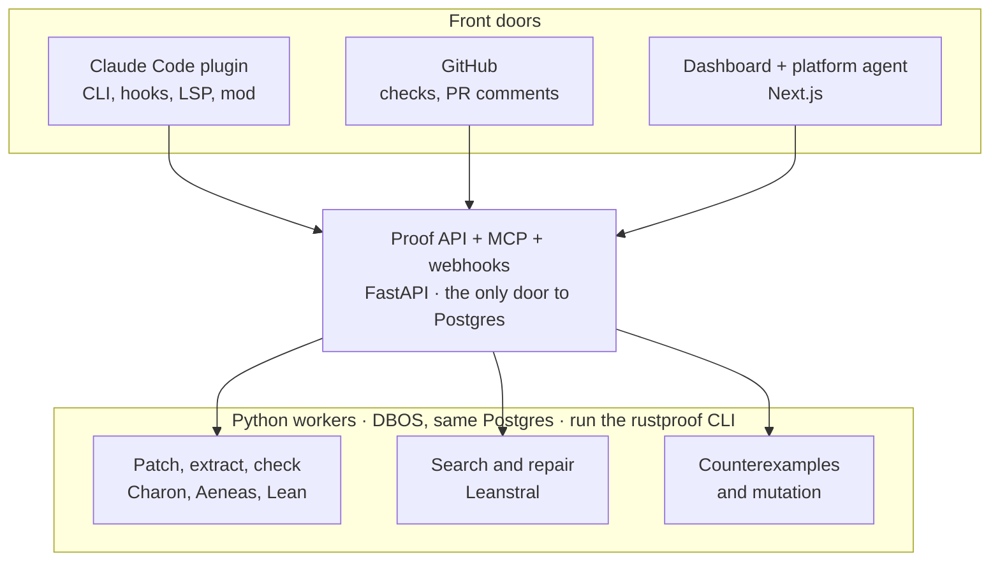

# rustproof — Design Document

**Vibe code it. Prove it.**
Version 0.2 · October 2026 · Retry AI LLC

> Your CI/CD system becomes your build engineer. No more "trust me bro."

---

## 1. Summary

Agents now write most code. When an agent writes Rust in Claude Code, rustproof proves that the Rust does what it's supposed to do, and keeps it proven on every commit.

rustproof takes a Rust crate, finds the functions whose behavior can be proven, patches them at build time into the subset of Rust that the Aeneas verifier accepts, extracts that Rust to Lean 4 with Charon and Aeneas, proposes theorems in plain English and Lean, generates the proofs with Leanstral, and checks every proof with the Lean kernel. **The patched code is the code that ships.** Everything that can't be proven (I/O, the network, the clock, unsafe code) stays outside the proof boundary and is covered by tests.

A Python service gets the same treatment: rustproof ports its pure decisions to Rust, calls them from Python through a compiled extension, and proves the Rust (§9). That is how rustproof proves its own Python backend.

There are two ways in:

| | Write time | Legacy code |
| --- | --- | --- |
| Who | A developer vibe-coding Rust with Claude Code | A team with an existing Rust crate |
| What rustproof does | Guides the agent to write provable Rust from the start, so the build-time patch is nearly empty | Generates build-time patches so the shipped build is provable without anyone rewriting the source by hand |
| What the developer sees | A proof pane in Claude Code, and a theorem to approve | Before/after diffs, and theorems to approve |

Both run the same pipeline and both end the same way: a build whose proven functions are proven against the exact code in that build.

rustproof ships as four surfaces over one backend:

| Surface | Analogy | Job |
| --- | --- | --- |
| `rustproof` CLI + Claude Code plugin (with a mod) | — | Where developers and their agents work, with rustproof's own panes inside Claude Code |
| GitHub integration | CircleCI | Gates every PR and every merge |
| rustproof cloud | — | Proof search, repair, caching, counterexamples |
| Platform agent | Railway's agent | Explains, debugs and repairs from the dashboard |

---

## 2. Thesis

1. **Agents write the code, so write Rust.** If nobody types the code by hand, the language should be the one with the best verification story. Rust has Charon and Aeneas, which turn safe Rust into pure functions a proof assistant can reason about. When the codebase is Python, the decisions inside it are ported to Rust and called through inter-op, so the same proofs apply.
2. **Monorepos are the default.** Agents build across a whole platform (a Cargo workspace), not a single library. The workspace's dependency graph is what tells rustproof which proofs a change invalidated.
3. **Tests enforce behavior, not functions.** The unit of verification is a behavior the system must keep, not a function that happens to exist today. For pure functions, that behavior is a theorem.
4. **Prove whenever possible.** Rust → Charon → Aeneas → Lean → Leanstral. Code that can't be extracted as written gets patched into the provable subset at build time.
5. **I/O is a boundary, not a blocker.** Exclude I/O and other complex operations from proofs, and prove the code before and after them. When the code after an I/O call takes the result as an argument, the theorem holds for every possible response, which is stronger than any mock.
6. **The CI/CD system becomes your build engineer.** It doesn't just report failures. It repairs what it is allowed to repair, patches what it is allowed to patch, and escalates what it isn't.

---

## 3. Design principles (the trust model)

Every surface enforces these the same way.

**The proven code is the running code.**
rustproof proves the patched tree, and the patched tree is what gets compiled and shipped. The developer's source file is their view of the code, the way source is a view of macro-expanded code. The build records the hash of the patched tree and stamps release artifacts with it, so "proven" always means "proven against the tree this was built from." This holds when release builds go through `rustproof build`, or when the repo uses commit mode (`rustproof build --commit`), where there is only one tree. `rustproof init` recommends commit mode for new code and patched-tree mode for legacy code, and the dashboard shows whether the last release reported a proven tree hash.

**What you're trusting.**
A proof shrinks trust to a short list: the Lean kernel and the Mathlib it builds on; Aeneas's translation and its models of the standard library; Charon, which describes itself as beta software with documented edge cases; the Rust compiler, which is a pinned nightly for extraction and your release compiler for the build; and the signatures rustproof declares for excluded functions. Every obligation lists its trust base, including which excluded functions its proof assumes exist.

**Specs are the review surface. Proofs are not.**
The Lean kernel rejects every invalid proof, so proof generation can be fully automated. Nothing checks a *spec* except a person. Humans review theorem statements, in plain English first and Lean second. They never need to read a proof.

**Patches are visible, tested and reversible.**
A patch changes what ships, so it is never hidden. Every patch is shown as a before/after diff in Claude Code, in the PR, and in the dashboard. Before and after both compile, so rustproof runs them on the same generated inputs (differential tests) and runs the project's own tests on the patched build. Any patch can be rejected per function, which moves that function outside the proof boundary.

**The build engineer has limited authority.**

| May do on its own | Never without a human |
| --- | --- |
| Write and repair proofs | Change a theorem statement (spec) |
| Apply patches from the built-in brick library (visible, tested, reversible) | Apply a custom brick, or any patch an org has set to require approval |
| Commit anything under `.rustproof/` except `specs/`: proofs, patches, the manifest, the Lean project | Commit to application source. In commit mode, patches are applied by the developer, or by Claude in their session where the person sees the diff. |
| Change caches and which functions to re-check | Move the proof boundary, or weaken any guarantee |

`.rustproof/specs/`, `.rustproof/patches/` and the manifest live under CODEOWNERS, so branch protection enforces this rather than policy alone. Approvals recorded locally (in the pane or a terminal) are advisory and carry their origin; the PR review is the gate that's enforced.

**No escape hatches.**
The build fails on `sorry`, on any axiom outside the approved set (Lean's three standard axioms plus the declared signatures of excluded functions, checked with `#print axioms`), and on any proof that relies on unchecked evaluation.

**Specs must have teeth.**
rustproof mutates the patched Rust and re-checks. A spec whose proof still goes through for a mutant is flagged as a weak spec. This is a cheap heuristic that catches specs which don't constrain the code; it is not a completeness guarantee.

**The runtime matches the model.**
Aeneas models integer overflow as a failure. Rust panics on overflow in debug builds but wraps silently in release builds. The patched build turns overflow checks on, so the running code fails exactly where the model says it fails, inside and outside every precondition.

**Checking is cheap and local. Finding is expensive and remote.**
Checking a proof is deterministic and fast (the Lean kernel plus Lake's build cache), so it runs locally and in hooks. Finding or repairing a proof is GPU-heavy and parallel, so it runs in the cloud.

**Counterexamples beat "proof failed."**
When a proof fails, rustproof looks for a concrete input that breaks the claim. "`fib(94)` overflows u64" is a bug report. "Proof failed" is not.

---

## 4. Worked examples

### Fibonacci (Rust)

A developer asks Claude Code for a Fibonacci function and gets a typical vibe-coded answer.

**Before (what the agent wrote)**

```rust
use std::collections::HashMap;

pub fn fib(n: u64) -> u64 {
    fn go(n: u64, memo: &mut HashMap<u64, u64>) -> u64 {
        if n < 2 {
            return n;
        }
        if let Some(&v) = memo.get(&n) {
            return v;
        }
        let v = go(n - 1, memo) + go(n - 2, memo);
        memo.insert(n, v);
        v
    }
    go(n, &mut HashMap::new())
}
```

**After (the build-time patch, brick `memo-to-accumulator`)**

```rust
pub fn fib(n: u64) -> u64 {
    if n == 0 {
        return 0;
    }
    let mut a: u64 = 0;
    let mut b: u64 = 1;
    let mut i: u64 = 1;
    while i < n {
        let next = a + b;
        a = b;
        b = next;
        i += 1;
    }
    b
}
```

The memoized version uses `HashMap`, which Aeneas has no model for. The brick replaces it with two accumulators and stops one step early, so the loop never computes a value the function doesn't return. The diff is small, readable, and shown to the developer. Both versions compile, so rustproof runs them on every input in the precondition (the domain is tiny here; larger domains are sampled) and confirms they agree.

**Proposed theorem**

> For every 64-bit integer n where n ≤ 93, `fib(n)` returns the n-th Fibonacci number.

```lean
def fibSpec : Nat → Nat
  | 0 => 0
  | 1 => 1
  | n + 2 => fibSpec (n + 1) + fibSpec n

theorem fib_spec (n : U64) (h : n.val ≤ 93) :
    ∃ r, fib n = ok r ∧ r.val = fibSpec n.val
```

**What the proof surfaced.** fib(93) = 12,200,160,415,121,876,738 fits in a u64. fib(94) doesn't. The theorem needs the precondition `n ≤ 93`, and that precondition is a real fact about the code that no unit test like `fib(10) == 55` would reveal. rustproof finds the bound before it proposes the spec: a short search for inputs that make the patched function fail turns up `fib(94)` at once, so the first proposed theorem already carries the precondition, with the counterexample attached as evidence.

The same discipline caught a bug in this document. The first draft of the patched loop ran one iteration too many and computed fib(n+1) on its way to returning fib(n), so it overflowed at n = 93 while still returning the right value. The theorem `n ≤ 93` was false for that code, and the kernel would have rejected its proof. A test of the return value would have passed.

This is the canonical **spec review moment**. The developer chooses:

- **Accept the precondition** and guard it at the boundary (callers get an error for n > 93).
- **Widen the type** to `u128` (good up to fib(186)) and re-prove.
- **Make overflow explicit** (`checked_add`, returning `Option<u64>`) and handle `None`.

Every option is legitimate. The point is that the system forces the decision instead of hiding it.

### A Python backend

The same pipeline proves the decisions inside a Python service by porting them to Rust and calling across the boundary. A FastAPI billing handler calls this function:

```python
# billing/prorate.py
def prorate(amount_cents: int, days_used: int, days_in_period: int) -> int:
    return amount_cents * days_used // days_in_period
```

`rustproof python candidates` finds it: pure, fully type-hinted, no I/O. The agent ports it, guided by the `port-python` skill, straight into the provable subset:

```rust
// .rustproof/crates/billing/src/lib.rs
pub fn prorate(amount_cents: u64, days_used: u64, days_in_period: u64) -> u64 {
    amount_cents * days_used / days_in_period
}
```

The build-time patch replaces the Python body with a call into the compiled extension, guarded by the approved precondition. Inputs outside the precondition take the original Python path, so behavior outside the proof is exactly what it was:

```python
# patched tree
from rustproof_ext.billing import prorate as _prorate_rs

def _prorate_ok(a: int, u: int, d: int) -> bool:          # generated from the approved spec
    return 0 < d and 0 <= u <= d and 0 <= a and a * u <= 18_446_744_073_709_551_615

def prorate(amount_cents: int, days_used: int, days_in_period: int) -> int:
    if _prorate_ok(amount_cents, days_used, days_in_period):
        return _prorate_rs(amount_cents, days_used, days_in_period)   # proven
    return amount_cents * days_used // days_in_period                 # original
```

**Proposed theorem**

> For every amount, days used and period length where the period is at least one day, the days used don't exceed it, and amount × days used fits in 64 bits, `prorate` returns at most the amount.

```lean
theorem prorate_spec (a u d : U64) (hd : 0 < d.val) (hu : u.val ≤ d.val)
    (hf : a.val * u.val ≤ U64.max) :
    ∃ r, prorate a u d = ok r ∧ r.val ≤ a.val
```

**What the proof surfaced.** Two things the handler never checked: a zero-day period divides by zero, and a large amount over a long period overflows 64 bits. The failure search reports `prorate(100, 1, 0)` before the spec is proposed, so the precondition arrives with the theorem. The team decides: reject a zero-day period at the API boundary with a 400, or keep the guarded fallback. Either way, every call inside the precondition now runs proven code, and the proof says a customer is never charged more than the full amount.

**What a port can't prove.** Nothing formally relates the Python to the Rust. Python integers are unbounded and `//` floors toward negative infinity, while the port uses `u64` and truncating division. So a port is validated like a patch: by differential tests (generated inputs; both versions must agree, or both must fail) and by the person reading the diff. The precondition keeps the proven path on inputs where the two semantics coincide.

This is how rustproof proves its own Python backend: the platform's authorization and quota decisions are ported, proven, and called through the extension from the deployed API.

### Dogfooding: rustproof proves rustproof

rustproof's CLI is Rust and its platform API is Python, so rustproof runs on both of its own paths. The CLI's core decisions are written in the provable subset and proven as-is:

- The status state machine: a function is `proven` only with an approved spec and a checked proof, and a changed source always means `stale`
- The policy check: no `sorry`, no disallowed axioms
- The merge-gate verdict: no failing, counterexample or stale obligation ever yields a green check

And the platform's Python decisions are ported and proven through the inter-op path: who may approve a spec, and whether a run may start under an org's quota.

The decisions themselves are proven; the parsers, the database and the API around them are shell and are not. That's also the landing-page demo.

---

## 5. Bricks

A patch is one instance of a **brick** at one site. Bricks are the reusable part, and there are two kinds.

**Rewrite patterns.** Each one takes a shape of Rust that Aeneas can't extract and produces one it can.

| Brick | Before | After |
| --- | --- | --- |
| `memo-to-accumulator` | Memoized recursion with a `HashMap` | An accumulator loop |
| `extract-inner-loop` | Nested loops | The inner loop as its own function |
| `remove-labeled-break` | `break 'outer` / `continue 'outer` | A helper with an early return |
| `range-to-while` | `for i in a..b` | `while` with an explicit index and bound |
| `isolate-io` | A function that computes and does I/O | The pure half as its own function; the I/O half excluded |

Each brick has two qualities: its output is inside the Aeneas subset (tested against the pinned profile on every release, not proven), and it ships with a **proof template**, the loop invariant shape and tactic skeleton for that idiom. The prover starts from the template instead of from scratch; how much that helps is measured in Milestone 0.

Bricks that introduce helper functions name them predictably (`fib__inner`, `fib__pure`) and keep them private, so a brick never changes a crate's public API.

**Verified components.** A small `rustproof-std` of functions proven once, with their theorems shipped: checked sums, bounded searches, sorted merge. A patch swaps a call to one in, `rustproof build` adds the dependency to the patched tree, and the proof composes existing lemmas. This is how verified software scales.

**What a brick can't have** is a general proof that it preserves semantics. Rewrite rules can't be proven correct without a formal semantics of the source language, and an instance can't be checked in Lean either, because the "before" is by definition not extractable. So patches are validated by differential testing and by the person reading the diff. The proofs are about the patched code, which is what ships, so this gap affects confidence in the diff, not the correctness of the artifact.

The brick library is versioned. Bump a brick and its instances re-patch and re-prove. Orgs can add custom bricks; those require human approval per patch.

---

## 6. Product surfaces

### 6.1 `rustproof` CLI (Rust)

One Rust binary per platform, open source. It owns identity, runs the pipeline locally, applies patches, checks proofs, and talks to the platform. Every primitive is also callable as a `rustproof step` with JSON in and out, which is how the platform's workers run the same pipeline in the cloud. Its own core decisions are proven by rustproof.

- `rustproof login` / `logout` / `whoami` — browser OAuth, token in the OS keychain (device-code flow and a token variable for headless machines)
- `rustproof init` — scan the workspace, classify functions, create `.rustproof/`
- `rustproof python candidates` / `scaffold` / `check` — the Python front end: find portable spans, create the extension crate and the guarded patch, validate a port
- `rustproof patch` — apply bricks and write patches
- `rustproof diff` — show before/after for any function
- `rustproof spec` — propose, revise, list and approve theorems
- `rustproof prove` — request proof search from the cloud
- `rustproof check` — verify all proofs locally; policy checks (`sorry`, axioms)
- `rustproof build` — materialize the patched tree and build it (`--commit` applies the patches to the source tree instead)
- `rustproof test` — differential tests per patch, plus the project's own tests on the patched build
- `rustproof status` — obligations and their states
- `rustproof events --follow` — stream status changes (feeds the mod)
- `rustproof doctor` — check and install the local toolchain
- `rustproof step <name> --json` — run one pipeline primitive under the step protocol; what the platform's workers call
- `rustproof verdict` — map obligation statuses to a check conclusion, using the proven core
- `rustproof mcp` — run as a local stdio MCP server
- `rustproof auth header` — print an auth header for the plugin's remote MCP entry

### 6.2 Claude Code plugin

The main way people use rustproof. It bundles the CLI and moves the CI rules into the agent's own loop: CI reports a broken proof after the PR is opened, but a hook stops Claude before it can say it's finished.

| Plugin component | Purpose |
| --- | --- |
| `bin/` | The CLI on the Bash tool's PATH (a shim; a SessionStart hook installs the pinned platform binary) |
| Skills | `/rustproof:login`, `/rustproof:init`, plus `make-provable` (how to write Rust inside the subset, with the bricks as idioms), `port-python` (how to port a Python span into the subset) and `write-spec` |
| `.lsp.json` | Lean's language server, so proof diagnostics reach Claude after every edit |
| Settings hooks | The floor: re-scan after `.rs` edits, block spec edits and self-approval, and block finishing while a proof fails or a `sorry` remains. Work even where mods are turned off. |
| Mod | The ceiling: rustproof's own interface inside Claude Code (below) |
| `.mcp.json` | Remote rustproof MCP (auth via the CLI) and lean-lsp-mcp |
| `userConfig` | Region, team, and other non-secret settings |

#### The rustproof mod

A mod runs inside Claude Code, so rustproof can draw its own interface there instead of printing text.

- **Status band** above the prompt, shown only when something needs attention or a run is active, worst first: `rustproof∎  ✕ 1 counterexample  ◆ 1 needs review  ◌ searching 3/5  ● 12 proven`. Digit hotkeys jump to the right tab.
- **Proof pane**, opened with `/proofs`, even while Claude is working. Tabs: Obligations, Needs you, Run, Coverage.
- **Spec and patch review in the terminal.** The before/after diff with its brick name, the theorem and its plain-English reading, and Approve and Request changes buttons. Claude can't press a mod's button, and the mod refuses Claude's attempts to approve from the shell, so an approval from the pane came from a person as far as the plugin can tell. Local approvals are recorded as advisory; the PR review is the enforced gate.
- **Live progress.** A suffix on Claude Code's own spinner line (`… · rustproof searching 3/5`), compact rows for rustproof tool calls instead of raw JSON, a one-line summary under each answer, and toasts when a proof lands or a counterexample turns up.
- **"More provable" suggestions.** When Claude writes a function outside the subset, the hook tells Claude which brick would apply, as context Claude actually reads, and the mod shows the same line to the person, so the agent writes the provable form directly and the patch stays near-empty.
- **Coverage heat map** per module: a cell grid in the terminal, SVG in the Desktop app.
- **Guards** that refuse edits to specs and generated Lean with instructions Claude can act on, and fail closed.

The mod draws in the Claude Code terminal and the Desktop app. Elsewhere (the VS Code extension, headless runs) its hooks still run and it falls back to plain transcript lines.

### 6.3 rustproof cloud (the platform)

One proof API, also exposed as a remote MCP server, behind every surface. It lives in a private repo, `rustproof-platform`, deployed to Railway.

- **API** — Python (FastAPI, Pydantic), with the MCP server mounted in the same app at `/mcp` and the GitHub webhook handlers alongside. It is the only network-facing interface to the platform's Postgres. It enqueues workflows and sends approvals through the DBOS client, but never runs workflows itself.
- **Workers** — Python, on DBOS Transact, sharing the same Postgres. They run the pipeline durably by calling the open-source CLI (`rustproof step …`) inside a worker image built on the public toolchain image, so there is one implementation of every primitive. The merge-gate verdict comes from the CLI's proven core (`rustproof verdict`) and is stored; the API only relays it.
- **Web** — rustproof.dev and the dashboard, built with Next.js; talks only to the API.
- **Check** — the Lean kernel with a content-addressed cache of build artifacts
- **Search and repair** — Leanstral, called through Mistral's hosted API in v1 and run as an agent against the obligation's Lean project with the Lean language server, many attempts in parallel, with the kernel as the judge. Self-hosting the open weights comes later.
- **Counterexamples** — property-based search and fuzzing against the patched Rust to find concrete failing inputs
- **Mutation** — mutant generation for weak-spec detection

### 6.4 Platform agent

Modeled on Railway's agent: one assistant in the dashboard that operates the platform, with the same tools exposed to outside agents over remote MCP and the CLI. Its jobs:

- Explain why a proof fails, in plain language, with the counterexample
- Propose spec changes (never apply them) and proof repairs (apply them)
- Explain a patch: which brick, why, and what the differential tests covered
- Recommend which functions to prove next, ranked by how provable and how important they are
- Debug a failing run: extraction errors, unsupported Rust, cache misses

### 6.5 GitHub integration

The CircleCI-shaped surface, acting as the build engineer on every PR.

- Listens to `pull_request`, `merge_group`, `check_run` (re-requested) and `installation` events; commits authored by the bot don't re-trigger a run
- Creates one `rustproof` check run per commit, with a section per affected crate and annotations on the exact Rust line
- Posts one sticky PR comment, in this order: new or changed patches as before/after diffs (they change what ships), the spec diff (plain English plus Lean), counterexamples, coverage change
- Pushes proofs, built-in-brick patches and manifest updates to the PR branch as `rustproof[bot]`; never specs or application source. Spec changes are proposed in the comment. On forks, it posts a patch block in the comment instead of pushing.
- Proposes a spec for any new provable function, which shows as `needs review`; the check reports `action_required` until a person approves, so unapproved code can't merge as proven
- Is a required status check whose verdict is computed (and proven) in the worker, so nothing merges with failing proofs
- Runs in the merge queue, so the combined result is verified before it lands. Merge-queue commits are immutable, so repairs happen at PR time; the queue only re-verifies.
- Pushes its commits before it requests review and never after a human approval, so "dismiss stale reviews" branch protection doesn't fight it

### 6.6 Architecture



### 6.7 One pipeline everywhere

**Two repositories.** `rustproof` is public (Apache-2.0): the CLI, the plugin, the bricks, `rustproof-std`, the proven core, the Lean helpers, the toolchain image, and the schemas that define the step protocol, the MCP tools, and the slice of the platform API the CLI uses. `rustproof-platform` is private: the website, the API and MCP server, the workers, Postgres, and the Railway deployment. The platform depends on the public repo through pinned releases; the public repo never depends on the platform, and everything in it works without an account.


Every pipeline primitive (scan, rank, patch, extract, propose specs, prove, check, mutate, counterexample, build, test, report) is an idempotent step keyed by content hash, written once in Rust and callable as `rustproof step <name> --json`. Whoever orchestrates it only has to remember where it is.

| Where | What runs | Who remembers progress |
| --- | --- | --- |
| Laptop and Claude Code | `rustproof` CLI | The CLI's step cache; a pending approval is `needs_review` in the manifest |
| rustproof cloud | Python workers calling `rustproof step …` | DBOS, with workflow state in the same Postgres as the platform's data |
| Self-hosted runner (later) | The same worker image on the customer's machines, pulling jobs from the API | DBOS on the customer's Postgres |
| Cloud API | FastAPI | Nothing; it enqueues workflows and sends approvals through the DBOS client |

Nobody needs Postgres to use rustproof; only the platform does. There, workflow state is co-located with the application data on purpose: a step that writes to an app table commits that write and its own checkpoint in one transaction, so platform writes from workflows happen exactly once, with no outbox table, no polling, and no reconciliation job.

- **Resumable.** A crashed worker resumes from its last checkpointed step; a laptop rerun skips cached steps.
- **Effectively once.** Every external side effect is idempotent (the PR comment updates in place; a bot commit is skipped when the tree already matches; usage is keyed by run id).
- **Human gates are durable waits.** In the cloud, the workflow blocks on a durable receive until the approval arrives, across restarts. Locally there's no engine, so the pipeline stops at `needs_review` and `rustproof spec approve` re-enters it.
- **Fan-out with limits.** Queues cap concurrent proof-search calls.

The manifest in the repo remains the source of truth for obligations. The engine holds execution history.

**Why not beads.** Beads (and Gas City, which builds on it) tracks what work exists and what's ready for agents. It doesn't checkpoint or resume running work. rustproof integrates with it instead: obligations that need a person can be published as beads issues.

---

## 7. Onboarding and the core workflow

People are already working in Claude Code, so onboarding happens there.

| # | Step | Where | Notes |
| --- | --- | --- | --- |
| 1 | Install the plugin | Claude Code | One command once it's in a marketplace |
| 2 | `/rustproof:login` | Claude Code → browser | OAuth; sign-up happens inside the same browser flow |
| 3 | `/rustproof:init` | Claude Code (CLI) | Scans the workspace and classifies every function as a provable, patchable or excluded candidate; extraction confirms the classification |
| 4 | Patch and extract | Claude Code (CLI); the cloud or local Docker for extraction | Applies bricks and shows each before/after diff. At write time the patch is nearly empty. |
| 5 | Propose theorems | Claude Code | **Human approval gate.** Nothing proceeds until specs are approved, in the rustproof pane, a terminal, the dashboard, or the PR review. |
| 6 | Generate proofs | Cloud (Leanstral) | Proof search runs remotely; long calls run in the background |
| 7 | Verify and build | Local | Lean kernel check, policy checks, then build the patched tree with overflow checks on |
| 8 | Test the build | Local / CI | Differential tests per patch, plus the project's existing tests against the patched build |
| 9 | Every PR commit | GitHub | Check runs, annotations, proof repair, spec and patch diffs in the sticky comment |
| 10 | Every merge | GitHub + merge queue | Verifies the combined result before it lands |

**Write time, in practice:** Claude writes a function → the PostToolUse hook re-scans → if the function is outside the subset, the mod names the brick and Claude rewrites it the provable way → a spec is proposed → the person approves it in the pane → the proof lands → the obligation shows `●`. The Stop hook won't let Claude declare the task done while a proof its edits broke is still failing, without at least saying so.

**Legacy code, in practice:** `/rustproof:init` on an existing crate reports coverage (how much is provable as-is, how much with patches, how much is excluded and why). The team reviews the patch diffs, approves specs for the functions that matter, and merges. From then on, every PR is gated.

---

## 8. Authentication

**The CLI owns identity.** `rustproof login` runs a browser OAuth flow (PKCE, loopback redirect) and stores the token in the OS keychain. One login covers Claude Code, hooks, and the terminal. Headless machines (CI, devcontainers, Claude Code cloud sessions) use `rustproof login --device` (a device-code flow) or a `RUSTPROOF_TOKEN` variable instead of a browser and keychain.

**The plugin's remote MCP server borrows that identity.** Its `.mcp.json` entry uses a `headersHelper` that asks the CLI for a bearer token. Claude Code reruns the helper on a 401, so refresh lives in one place.

```json
{
  "mcpServers": {
    "cloud": {
      "type": "http",
      "url": "https://mcp.rustproof.dev/mcp",
      "headersHelper": "\"${CLAUDE_PLUGIN_ROOT}\"/bin/rustproof auth header"
    }
  }
}
```

**The server still speaks standard MCP OAuth** (protected-resource metadata, dynamic client registration), so the same endpoint works as a claude.ai connector and in other MCP clients.

**CI never uses a person's token.** The GitHub integration authenticates with its installation token.

---

## 9. The proof boundary

### What gets proven

Pure, deterministic, typed functions: validation, parsing, pricing and scoring rules, data transformations, numeric kernels, state machines. How much of a real crate that covers is a measurement (Milestone 7), not a claim.

### What's excluded

I/O, network, filesystem, clocks, randomness, global mutable state, concurrency and async, unsafe code, FFI, and anything that depends on library types Aeneas has no model for and no brick can replace. Excluded functions are visible in every surface, with the reason, so the proof boundary is never hidden.

### Aeneas constraints (check the pinned release)

Aeneas functionalizes a subset of safe Rust. At the time of writing its README lists as unsupported: unsafe code, concurrency, some loop shapes (`return` inside nested loops, `break`/`continue` to an outer loop), and instantiating generics with mutable borrows. It only knows the library types it has models for, and there is no model for `HashMap`. The real ceiling in practice is library coverage. Charon, which Aeneas depends on, describes itself as beta software with known edge cases, so it is part of what a proof trusts. rustproof tracks the supported subset as a versioned profile and tests its bricks against it.

### Overflow

Aeneas models arithmetic so that overflow is a failure, matching Rust's debug-build behavior. Release builds wrap silently. The patched build sets `overflow-checks = true` for the workspace's own crates (not for dependencies), so the shipped binary matches the model everywhere, and a theorem's precondition is exactly the set of inputs on which the code doesn't fail.

### Python: inter-op ports

A Python project goes through the same pipeline with one extra front end. `rustproof python candidates` finds pure, fully type-hinted spans (no I/O, no globals, no exceptions crossing the boundary); the agent ports each one to Rust under `.rustproof/crates/`, written directly in the provable subset; and the build-time patch replaces the Python body with a guarded call into a compiled extension (PyO3, built with maturin). From there the pipeline is the Rust pipeline: extract, spec, prove, check.

| Python | Rust port | What covers the gap |
| --- | --- | --- |
| Unbounded `int` | Fixed-width integers | A precondition in the spec, and the guard |
| `//` floors toward −∞ | `/` truncates toward zero | They agree for non-negative operands; the precondition keeps the proven path there |
| Exceptions | `Result` | The extension raises the matching Python exception |
| Shared mutable lists and dicts | Owned values | Only spans with value semantics are candidates |
| `str` indexing by code point | UTF-8 bytes | Spans that index strings aren't candidates in v1 |
| Duck typing | Static types | Type hints are required; the guard rejects other types |

**Guarded ports.** The patch dispatches on the approved precondition, generated as Python from the spec. Inside it the proven Rust runs; outside it the original Python runs unchanged. Behavior outside the proof is therefore identical to before, and the proof is exact inside it. The guard is tested with the differential tests.

**The cost of the boundary.** A call into Rust costs about 30 nanoseconds plus a few per argument, which is more than a tiny Python function costs. So candidates are whole loops rather than loop bodies, every port is timed in the differential tests, and a port that is slower than the Python it replaces is flagged.

**What ships.** The patched Python tree plus the compiled extension, built by `rustproof build` with maturin and stamped with the same provenance hash as a Rust project.

### Patches

Everything lives under `.rustproof/` and is committed, except the local step cache:

```
.rustproof/
  manifest.toml     # obligations, source hashes, bricks, approvals, patched-tree hash
  patches/          # one patch per obligation (may be empty); Python patches are guarded inter-op calls
  crates/           # ported Rust for Python projects (PyO3 extension crates)
  specs/            # theorem statements (CODEOWNERS-protected)
  proofs/           # generated proofs
  lean/             # Lake project; Generated/ is Aeneas output; .lake/ is never committed
  state/            # local step cache (never committed)
```

Each obligation is keyed to the hash of its generated Lean (its own and its callees'). A source edit marks it **stale**; the patch is re-derived and the function re-extracted, never applied blindly. If the regenerated Lean is identical, the existing proof is kept and the obligation returns to proven without a new search. `rustproof build` materializes the patched tree under `target/rustproof/` and builds from it; `rustproof build --commit` applies the patches to the source tree instead, for teams that prefer one tree.

---

## 10. Status vocabulary

One shared set of states across the CLI, Claude Code, GitHub, and the dashboard.

| State | Glyph | Meaning | Who acts |
| --- | --- | --- | --- |
| **Proven** | `●` | Spec approved, proof checked by the Lean kernel, against the current patched tree | No one |
| **Checking** | `◌` | Local or cloud verification running | System |
| **Searching** | `◌` | Proof search or repair running | System |
| **Needs review** | `◆` | A spec, or a patch that requires approval, is waiting for a person | Human |
| **Failing** | `✕` | Proof doesn't check and repair hasn't succeeded | Agent, then human |
| **Counterexample** | `✕` | A concrete input breaks the claim | Human (fix code or spec) |
| **Weak spec** | `△` | Spec still holds for a mutant | Human |
| **Stale** | `↻` | The function changed since it was patched or proven | System (re-patch, re-prove) |
| **Excluded** | `○` | Outside the proof boundary, with a reason (I/O, unsafe, unsupported, patch rejected) | No one |

Glyph plus label carry the meaning, so every surface works without color, including GitHub Markdown and plain terminals. Two pairs share a glyph (the two in-progress states, the two failure states) because they call for the same response; the label tells them apart.

---

## 11. Brief for Claude Design

Use the companion **rustproof Design System** document for visual language. Design these surfaces, in this order:

1. **rustproof.dev landing page.** Hero: "Vibe code it. Prove it." The Fibonacci example told as a four-beat story: vibe-coded Rust → the patch (before/after) → the theorem → `∎ Proven`, with the fib(94) overflow as the "aha." A second story for Python backends: a FastAPI billing handler → the ported Rust → the theorem → `∎ Proven`, with `prorate(100, 1, 0)` as the "aha." A "rustproof proves rustproof" section showing the merge-gate rule and the platform's approval rule as proven theorems. Three steps to start: install the plugin, log in, run init. CTA: install the Claude Code plugin.
2. **Sign-in and OAuth consent.** Sign up and sign in in one flow; device and scope shown clearly; success screen tells the user to return to Claude Code.
3. **Dashboard home.** Repos, proof coverage (share of provable functions that are proven), recent runs, and a "needs you" queue (Needs review, Counterexample, Weak spec).
4. **Repo view.** Tree of crates, modules and functions with status, coverage, and the proof boundary (excluded functions shown with their reason, not hidden).
5. **Run detail.** Obligations with states, timing, cache hits, logs, the patched-tree hash, and the trigger (commit, PR, merge queue).
6. **Spec review.** Three columns: Before (the developer's Rust), After (the patched Rust, with the brick named), Claim (plain English, then Lean). Approve or request changes. Diff mode for changed specs. This is the most important screen in the product.
7. **Patch review.** The before/after diff with the brick's name and description, the differential-test summary, and Approve, Reject (exclude this function) or Choose another brick.
8. **Counterexample view.** The failing input, expected vs actual, the line, and the three standard resolutions (precondition, widen, make explicit).
9. **Platform agent panel.** A docked conversation that knows the current repo, run, or obligation, with suggested actions.
10. **GitHub surfaces.** Check-run summary and the sticky PR comment. Markdown-only, so design with tables, headings, status glyphs and diffs, not color.
11. **Claude Code surfaces (the mod).** The status band, the proof pane and its four tabs, spec and patch review inside the pane, the "more provable" nudge, the spinner suffix, compact tool rows, the turn summary line, and the coverage heat map. Monospace, box-drawing borders, status glyphs, hotkeys shown as `1: Obligations`. Also the Desktop app variant, which can use SVG.
12. **CLI output.** Monochrome plus status glyphs, one line per obligation, summary last.
13. **Settings.** Organization, GitHub installation, members, CLI sessions, patch policy (auto or required approval), billing placeholder.

Include empty, loading, first-run and error states for each.

---

## 12. Open questions

- **Pricing.** Per proof-minute, per repo, or per seat?
- **Name and marks.** "rustproof" is a Rust-specific product name. Check the Rust Foundation's trademark policy before anything public, and avoid any visual reference to the Rust logo.
- **Code privacy.** Assumption for v1: customers trust rustproof's cloud with their code and proofs, so everything runs there, for speed. Later, for banks and other sensitive customers: self-hosted runners that pull jobs from the API and send back only results, with proof search on the customer's own GPUs (Leanstral has open weights).
- **Prover choice and hosting.** v1 calls Mistral's hosted Leanstral API. Self-hosting the open weights (a large mixture-of-experts model) is a cost decision for later. Keep the prover interface model-agnostic.
- **Renames.** Obligations are keyed by function path. A rename is detected by matching the normalized body hash; otherwise it's a delete plus an add, and the person confirms carrying the approved spec over.
- **Patch policy defaults.** Auto-apply built-in bricks, or require approval for every patch? Proposed: auto for built-in, required for custom, per-org override.
- **Debugging patched code.** Panics and stack traces point into the patched tree. Is a materialized tree plus small diffs enough, or do we need a source-map-like view?
- **Other languages.** Rust is first-class and Python is supported through inter-op ports (§9). TypeScript could follow the same pattern with Rust compiled to WebAssembly; it isn't planned.
- **Guarded ports.** The guard keeps the original Python for inputs outside the precondition. Should a repo be able to opt into "no fallback" (raise instead), so the proven path is the only path?
- **Unsafe Rust.** Watch tools that extend Lean verification to unsafe Rust (for example Anneal in Google's zerocopy project).

---

## 13. Glossary

- **Charon** — extracts Rust's MIR into LLBC, an intermediate form for verification
- **Aeneas** — translates LLBC into pure functional code for theorem provers, including Lean 4
- **Lean / Lake** — the proof assistant and its build system
- **Leanstral** — Mistral's open-weight proof agent for Lean 4
- **Obligation** — one function, its patch, its spec, and its proof status
- **Patch** — the build-time rewrite of one function into the provable subset; may be empty
- **Brick** — a reusable rewrite pattern (with a proof template) or a verified component; patches are instances of bricks
- **Patched tree** — the source tree with all patches applied; the thing that is extracted, proven, built and shipped
- **Inter-op port** — a Python span rewritten in Rust and called from the patched Python through a compiled extension
- **Guard** — the generated precondition check in a Python patch; inside it the proven Rust runs, outside it the original Python runs
- **Spec / theorem** — the claim about a function; reviewed by humans
- **Proof** — the machine-checked argument for a spec; never reviewed by humans
- **Proof boundary** — the line between proven code and the excluded shell
- **DBOS** — durable workflows on Postgres; the platform's engine, with workflow state in the same database as the platform's data
- **Mod** — a Claude Code plugin component that runs inside Claude Code and can draw interface
- **Beads** — a git-backed work tracker for coding agents; rustproof publishes "needs you" items to it

---

## References

- Aeneas: https://github.com/AeneasVerif/aeneas
- Charon: https://github.com/AeneasVerif/charon
- Leanstral: https://mistral.ai/news/leanstral/
- Claude Code plugins reference: https://code.claude.com/docs/en/plugins-reference
- Claude Code MCP (OAuth, headersHelper): https://code.claude.com/docs/en/mcp
- Claude Code mods: https://code.claude.com/docs/en/plugins/mods/overview
- DBOS, "Co-locating workflow state with your data": https://dbos.dev/blog/co-locating-workflow-state-with-your-data
- DBOS Python docs: https://docs.dbos.dev/
- MCP Python SDK: https://github.com/modelcontextprotocol/python-sdk
- Beads: https://github.com/steveyegge/beads
